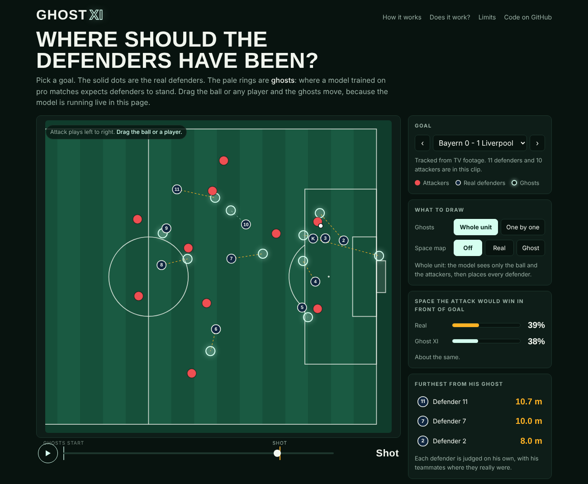

# Ghost XI

When a team concedes a goal, where should the defenders have been?

Ghost XI answers that with "ghosts". A ghost is where a typical pro defender would be standing, given how the play unfolded. Put the ghosts next to the real defenders and you can see who was out of position, and by how much.

Pro clubs call this ghosting. I love soccer, so I wanted to build it myself.

[](https://julianmunozcarrera.github.io/ghost-xi/)

## In short

- **3.5 m.** How far the ghost lands from the real defender, guessing 5 seconds ahead. The best simple rule misses by 8.1 m.
- **23 matches.** 20 of them tracked from the normal TV broadcast, where about 14 of 22 players are on screen.
- **4 ms.** One run of the model. It is small enough to run live in a web page.
- **One honest surprise.** Being far from your ghost does not predict goals. Details below.

## Try it

**[Open the live demo](https://julianmunozcarrera.github.io/ghost-xi/)**

Pick one of 19 real Liverpool goals. Press play. Then drag the ball or any player and watch the ghosts react. The model runs right in the page, with no server.

(The whole site is one file, `docs/index.html`. You can also just open that file.)

## How it works

1. **Watch.** The model studied 345,504 moments from 23 pro matches. Each moment is the position of the ball and the players.
2. **Hide and guess.** In training we hide a defender and ask: he stood here a few seconds ago, the play went like this, where is he now? The model guesses, we show it the truth, and it gets a little better. Repeat 2 million times.
3. **Compare.** On a new goal, the model's guess is the ghost.

The model is a small transformer with 102,082 parameters. Every player and the ball is one "token", and each token looks at all the others before answering. It is small on purpose, so it can run in a web page in a few milliseconds.

### Built for TV footage

A TV camera only shows part of the pitch. On average about 14 of the 22 players are on screen. Most ghosting work assumes you can see everyone. This model does not:

- Players who are off screen are simply left out. The model works with whoever it can see.
- 20 of the 23 training matches were tracked from the normal TV broadcast, so it learned on the real thing.
- For the 3 matches where everyone is visible, half the time I hide the players far from the ball, to imitate a TV camera.

## The data

All of it is open. Thank you to the people who shared it.

| Data | What it is | Used for |
|---|---|---|
| [Metrica Sports](https://github.com/metrica-sports/sample-data) | 3 matches tracked in the stadium, all 22 players | Training and testing |
| [SkillCorner](https://github.com/SkillCorner/opendata) | 20 A-League matches tracked from the TV broadcast | Training and testing |
| [Last Row](https://github.com/Friends-of-Tracking-Data-FoTD/Last-Row) | 19 Liverpool goals from 2019, tracked from TV | The demo. Never used in training |

In total: 1,213 minutes of live play.

## Results

Every number is from matches the model never saw. The 23 matches are split into 4 groups. I train 4 times, each time leaving one group out, and test on the group that was left out.

### Does the ghost move like a real defender?

I hide the whole defense and ask where each defender will be some seconds later. The table shows the average miss in meters. Lower is better.

| Seconds ahead | Stand still | Move with the ball | **Ghost XI** |
|---|---|---|---|
| 1 | 2.6 | 2.6 | **0.5** |
| 2 | 5.0 | 4.5 | **1.4** |
| 3 | 7.1 | 6.0 | **2.2** |
| 5 | 10.7 | 8.1 | **3.5** |
| 8 | 14.6 | 10.2 | **4.6** |

More checks, all 5 seconds ahead:

| Check | Result |
|---|---|
| One defender hidden. Ghost XI vs the rule "move like your teammates" | 3.5 m vs 5.9 m |
| Matches tracked from TV only | 3.5 m |
| Matches tracked in the stadium only | 3.3 m |

So the model is more than twice as close as the best simple rule, and it holds up on TV tracking.

### Does being far from your ghost mean you made a mistake?

This is the part I expected to work, and it did not.

I ran the ghosts on three kinds of moments, starting 8 seconds before each one. "Off by" is the distance between a defender and his ghost.

| Kind of moment | How many | Average defender off by | Worst defender off by |
|---|---|---|---|
| Ordinary moments near goal | 4,818 | 4.3 m | 8.8 m |
| Shots that did not go in | 422 | 4.2 m | 8.6 m |
| Goals | 57 | 4.5 m | 9.0 m |

If goals came from defenders being out of position, the goal row would be clearly higher. It is not. 4.5 m against 4.3 m is too close to call a difference.

I also checked if a defense made of ghosts would give the attack less space in front of goal. It gives up about the same (40% for both on goals).

What I take from this: **the ghost shows what a typical defender would do. Being far from it means you did something unusual. It does not mean you did something wrong.** A press, an offside trap or a smart gamble all look unusual too. The tool is good for finding the moments worth looking at. It cannot judge them for you.

### From TV picture to pitch positions

The last piece is turning a TV picture into positions on the pitch. I can not share real match footage, so this is tested with a pretend camera. It films a real match, and I add the mistakes a real system makes (things found a few pixels off, 1 in 10 landmarks plain wrong, 1 in 20 players missed).

| Measure | Result |
|---|---|
| Pictures tested | 11,250 (15 minutes of play) |
| Pictures where the camera angle could be worked out | 92.7% |
| Players in the picture, out of 22 | 13.9 on average |
| Typical position error | 0.25 m |
| Bad case position error (worst 5%) | 0.85 m |
| Ghost miss 3 s ahead, with perfect positions | 2.3 m |
| Ghost miss 3 s ahead, with positions from the camera | 3.4 m |

### The website runs the same model

The model is written three times: PyTorch for training, NumPy for analysis, JavaScript for the website. A test checks that the JavaScript version gives the same ghosts as Python. The biggest difference is under 0.001 m. One run takes about 4 ms.

## What it cannot do yet

- **It does not find players in video.** The matches were tracked from TV by SkillCorner and Last Row, not by me. My own camera stage is tested with a pretend camera. Finding players in real pixels needs a trained detector and real footage. That is the next step.
- **Far from the ghost is not the same as wrong.** See the results above.
- **23 matches is still little.** Clubs train on hundreds.
- **Open play only.** Corners and free kicks are a different game. The demo marks goals that start from a corner.
- **The danger score is simple.** It only asks who would reach each spot first. It knows nothing about passing lanes or who the striker is.
- **The Liverpool clips are rough.** Their makers say the tracking was built for animations.

## Run it

```bash
git clone https://github.com/JulianMunozCarrera/ghost-xi
cd ghost-xi
pip install -r requirements.txt
python -m pytest
```

The tests run without any data. A few extra ones switch on once the data is there.

Get the data (about 2 GB):

```bash
python scripts/get_data.py
```

Then, in this order. Each step uses what the one before it made.

```bash
# 1. Train 4 test models and the final one (about 40 minutes on a laptop CPU)
python scripts/train.py --metrica data/metrica/data --skillcorner data/skillcorner/data

# 2. Run the ghosts on every shot and goal
python scripts/analyse_goals.py --metrica data/metrica/data --skillcorner data/skillcorner/data \
    --lastrow data/lastrow/datasets/positional_data/liverpool_2019.csv

# 3. The pretend camera test
python scripts/camera_test.py --data data/metrica/data

# 4. Build the website
python scripts/build_site.py --lastrow data/lastrow/datasets/positional_data/liverpool_2019.csv
```

The trained models and all result numbers are already in `models/` and `results/`, so you can skip straight to any step.

## Where things are

| File | What it does |
|---|---|
| `ghostxi/tokens.py` | Turns a moment of play into the numbers the model reads |
| `ghostxi/samples.py` | Cuts matches into training examples |
| `ghostxi/model.py` | The model, in PyTorch, for training |
| `ghostxi/model_numpy.py` | The same model in plain NumPy, for everything else |
| `ghostxi/ghost.py` | Makes the ghosts for a clip |
| `ghostxi/danger.py` | Who would win the space in front of goal |
| `ghostxi/analysis.py` | Everything measured at the moment of a shot |
| `ghostxi/camera.py`, `ghostxi/tracker.py` | TV picture to pitch positions, and following players over time |
| `ghostxi/data_*.py` | One loader for each data source |
| `web/` | The website: `engine.js` is the model, `app.js` is the page |

## Credits

- Ghosting: Le, Carr, Yue and Lucey, "Data-Driven Ghosting using Deep Imitation Learning" (2017)
- Space control: William Spearman, "Beyond Expected Goals" (2018)
- Data: Metrica Sports, SkillCorner, and Last Row by Ricardo Tavares
